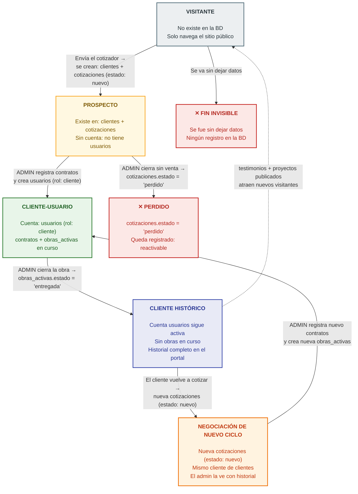

# FLUJO DE PERSONAS — Guía de lógica e interfaces

> **Qué es:** guía de referencia del software. Define las 4 realidades de una persona,
> qué interfaces ve cada una, y qué puede y qué no puede hacer. Sirve para diseñar el
> frontend y como contrato lógico: si algo no está acá, no está planeado.
> **Qué NO es:** un documento de base de datos. Solo menciona registros cuando eso
> aclara el comportamiento. No agrega ni modifica nada del esquema.
> **Convención:** los nombres en `code` (clientes, cotizaciones, contratos, usuarios,
> obras_activas, estado...) son tablas y campos exactos de `DATABASE.md`.
> El resto del texto es lenguaje de negocio.

---

## 1. Idea central

Las realidades **no son personas distintas ni etapas obligatorias: son situaciones
excluyentes**. En un momento dado, cada persona está en exactamente UNA realidad.
A lo largo del tiempo, una misma persona puede recorrer varias — o quedarse en una
para siempre.

- Un visitante puede que nunca llegue a prospecto.
- Un prospecto puede que nunca firme (nunca tenga `contratos` registrado).
- Un cliente-usuario siempre llega a cliente histórico (toda obra termina).
- El ciclo puede repetirse: el cliente histórico puede volver a ser cliente-usuario.

**Nadie cambia de realidad por el paso del tiempo: cada cambio lo dispara una acción concreta.**

---

## 2. Las 4 realidades

### VISITANTE

| | |
|---|---|
| **Quién es** | Persona anónima navegando el sitio |
| **Experiencia** | Sitio público completo |
| **En el sistema** | No existe (no dejó datos: ningún registro en la BD) |

**SÍ puede:**
- Navegar Home, Servicios, Portafolio, FAQ, Contacto
- Enviar el cotizador (eso lo convierte en prospecto)
- Escribir por WhatsApp
- Intentar login (le fallará: no tiene cuenta)

**NO puede:**
- Entrar al portal
- Crear una cuenta por sí mismo (no existe registro público)
- Ver datos de nadie

---

### PROSPECTO

| | |
|---|---|
| **Quién es** | Dejó sus datos, está en negociación, no tiene `contratos` registrado |
| **Experiencia** | La MISMA del visitante — ser prospecto no cambia el sitio |
| **En el sistema** | Existe en `clientes` + `cotizaciones` (estado en el embudo), pero **sin cuenta en `usuarios`** |

**SÍ puede:**
- Seguir navegando y cotizando de nuevo (se acumulan cotizaciones a su nombre)
- Negociar por WhatsApp / teléfono (fuera del sistema)

**NO puede:**
- Hacer login (no tiene cuenta en `usuarios`, y nadie se la crea hasta que haya contrato)
- Ver el estado de su cotización en línea (esa info viaja por WhatsApp)
- Saber que "es prospecto" — es una categoría interna que solo ve el admin

---

### CLIENTE-USUARIO

| | |
|---|---|
| **Quién es** | Tiene `contratos` registrado Y el admin le creó la cuenta en `usuarios` (rol: cliente) |
| **Experiencia** | Portal privado tras login |
| **En el sistema** | Cuenta activa + contrato + `obras_activas` en curso |

**SÍ puede:**
- Login con email y contraseña
- Ver SU obra: estado, progreso, avance con hitos
- Ver SUS pagos: historial, montos, comprobantes
- Ver SUS documentos: contrato en PDF
- Cerrar sesión y volver cuando quiera

**NO puede:**
- Ver obras, pagos o datos de otros clientes
- Ver notas internas del admin
- Ver nada de empleados, materiales ni herramientas (mundo interno)
- Editar o subir nada (el portal es de solo lectura)
- Aprobarse servicios a sí mismo

---

### CLIENTE HISTÓRICO

| | |
|---|---|
| **Quién es** | Sus `obras_activas` están en estado entregada; no tiene ninguna en curso |
| **Experiencia** | El mismo portal, mostrando historial |
| **En el sistema** | Cuenta en `usuarios` que **SIGUE activa** + historial completo |

**SÍ puede:**
- Login (su cuenta no se desactiva al terminar la obra)
- Ver todo su historial: obras terminadas, pagos pasados, documentos
- Iniciar un nuevo ciclo: nueva cotización
- Dar testimonio o referidos

**NO puede:**
- Retroceder a prospecto (nunca pierde su categoría, aunque cotice de nuevo)
- Auto-aprobar el nuevo servicio: el nuevo ciclo pasa por el admin como
  cualquier cotización — solo que el admin lo verá con historial, lo que hace
  el servicio más seguro

---

## 3. Mapa del flujo

Cada flecha indica **quién dispara el cambio** y **qué registro lo materializa en la BD**.

*Leyenda: cada realidad tiene su color; rojo = salidas del flujo; ámbar = negociación de un ciclo repetido. La flecha punteada es el circuito de retorno: la operación terminada alimenta el sitio público y trae nuevos visitantes.*

---

## 4. LO QUE NUNCA PASA (reglas duras)

Estas reglas son el contrato lógico del software. Si una idea futura contradice
alguna, la idea está mal o hay que discutir la regla explícitamente antes de cambiarla.

1. **Nadie se registra solo.** Toda cuenta en `usuarios` la crea/autoriza el admin.
2. **El prospecto no tiene portal.** Su experiencia es idéntica a la del visitante;
   su negociación vive en WhatsApp.
3. **El sitio público es uno solo para todos.** Ser prospecto o cliente no cambia
   lo que se ve fuera del login.
4. **El cliente histórico no retrocede a prospecto**, aunque cotice de nuevo.
5. **Cada cliente ve solo lo suyo.** Jamás datos de otros clientes.
6. **El portal es de solo lectura.** El cliente no edita ni sube nada.
7. **Las notas internas (`notas_internas`) nunca salen del panel admin.**
8. **El prospecto perdido nunca se borra** (es reactivo: puede volver como lead).
9. **La cuenta no se desactiva al terminar la obra** (el histórico sigue entrando).
10. **El visitante sin datos no deja rastro ni puede ser perseguido después**
    (no hay registro forzado).
11. **Empleados, materiales y herramientas nunca son visibles para clientes**
    (solo mundo admin).

---

## 5. Inventario de interfaces (frontend)

### A) Sitio público — lo ven visitante y prospecto
- [ ] Home
- [ ] Servicios
- [ ] Portafolio / Proyectos
- [ ] FAQ
- [ ] Cotizador (formulario que crea prospecto)
- [ ] Contacto + botón flotante de WhatsApp
- [ ] Pantalla de login (única entrada al portal)

### B) Portal del cliente — cliente-usuario y cliente histórico
- [ ] Login
- [ ] Inicio "Mi obra" (estado, progreso)
- [ ] Avance (hitos con fotos visibles para el cliente)
- [ ] Pagos (historial + comprobantes)
- [ ] Documentos (contrato en PDF)
- *Nota: si el histórico tiene varias obras, el portal necesita un selector/historial de obras.*

### C) Panel admin — el operador del flujo
- [ ] Embudo de cotizaciones (ver, cambiar `estado`, notas internas)
- [ ] Clientes (ficha + historial + deducir si es histórico)
- [ ] Autorizar cuentas (crear `usuarios` rol cliente)
- [ ] Obras (crear obra, hitos, pagos, marcar visibles para el cliente)
- [ ] Contenido público (proyectos, servicios, FAQ, certificaciones)
- [ ] (Futuro: empleados, materiales, herramientas)
